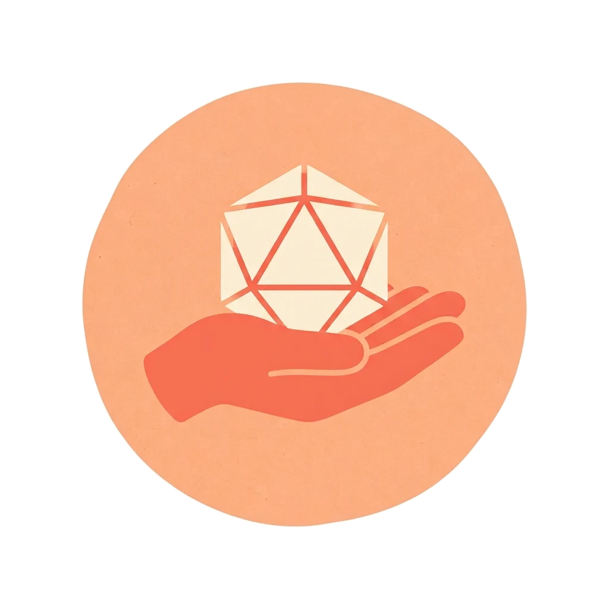

<div align="center">
    
    <h1>Tablehand</h1>
    <h3><em>Agent skills for running, writing, and chronicling tabletop RPG campaigns.</em></h3>
</div>

<p align="center">
    <strong>Each skill follows the Agent Skills specification, and the repo doubles as a Claude Code plugin marketplace, so one copy of each skill installs in Claude Code, other skills-compatible clients, and claude.ai.</strong>
</p>

<p align="center">
    <a href="https://github.com/tjmustard/tablehand/stargazers"></a>
    <a href="https://github.com/tjmustard/tablehand/blob/main/LICENSE"></a>
</p>

---

## Table of Contents

- [🤔 What is Tablehand?](#-what-is-tablehand)
- [📚 Skills](#-skills)
- [⚡ Get Started](#-get-started)
- [📂 Directory Structure](#-directory-structure)
- [🛠️ Adding a Skill](#️-adding-a-skill)
- [❓ Troubleshooting Overview](#-troubleshooting-overview)
- [🤝 Support](#-support)
- [📄 License](#-license)

## 🤔 What is Tablehand?

A single repository of **agent skills** for running, writing, and chronicling tabletop RPG campaigns. Every skill conforms to the [Agent Skills specification](https://agentskills.io/specification) and is validated in CI. Skills are grouped into **bundles** (Claude Code plugins) listed in `.claude-plugin/marketplace.json`, so each skill exists once and is installable everywhere.

## 📚 Skills

<!-- catalog:start -->
| Skill | Bundle | Description |
| --- | --- | --- |
| [campaign-chronicler](skills/campaign-chronicler) | tabletop | Turn a tabletop RPG session transcript into a detailed session file (a story recap plus exact quotes, people, places, items, and open threads) and add the session's canon to the campaign bible, a wide overview of the whole campaign. The bible only ever gains entries; nothing in it is edited or deleted. Use when the user shares a session transcript, recording text, or notes and wants a session recap, story, chronicle, or session notes, or wants their campaign bible, lore document, or campaign record updated or started. Not for new non-canon stories (use side-quest-writer) or character interviews (use character-profiler). |
| [character-profiler](skills/character-profiler) | tabletop | Interview a player about their tabletop RPG character in four rounds (soul and voice, motivations and flaws, shadows and scars, combat and problem solving), then compile a Behavioral Profile block that story and side-quest prompts use to keep the character true to themselves. Use when the user wants to profile, flesh out, or be interviewed about a D&D or other RPG character, or asks for a character profile, behavioral profile, or source material block for AI-written stories about their character. Not for building stats, a character sheet, or a backstory from scratch. |
| [side-quest-writer](skills/side-quest-writer) | tabletop | Write a comedic, non-canon "what-if" side-quest story starring the user's tabletop RPG characters, up to about 2,500 words in 3–5 chapters, built from their character profiles and past stories. Interviews the user about the premise, gets an outline of the characters' key decisions approved, writes one section at a time with approval before the next, then compiles the finished story in Markdown. Use when the user wants a side quest, what-if, filler episode, or funny short story about their D&D or other RPG party, or pastes Behavioral Profiles from character-profiler and asks for a story. Not for building a character profile (use character-profiler) or retelling what happened in a real session. |
<!-- catalog:end -->

## ⚡ Get Started

### Claude Code

1.  Add the marketplace:
    ```
    /plugin marketplace add tjmustard/tablehand
    ```
2.  Install a bundle:
    ```
    /plugin install tabletop@tablehand
    ```
3.  Pick up later changes:
    ```
    /plugin marketplace update tablehand
    ```

### Other Skills-Compatible Clients

```bash
npx skills add tjmustard/tablehand
```

### claude.ai

Package a skill and upload the zip under Settings > Capabilities > Skills:

```bash
make package name=<skill-name>
# uploads dist/<skill-name>.zip
```

## 📂 Directory Structure

```
tablehand/
├── .claude-plugin/marketplace.json   # marketplace "tablehand"; bundles reference skills by path
├── skills/                           # flat; one folder per skill; folder name == frontmatter name
│   └── <skill-name>/
│       ├── SKILL.md
│       ├── references/               # only if needed
│       ├── scripts/                  # only if needed
│       ├── assets/                   # templates the skill fills in
│       └── evals/                    # regression cases and fixtures, only if needed
├── template/SKILL.md                 # starter for new skills (outside skills/ so tools never load it)
├── prompts/                          # standalone prompts not yet promoted to skills
├── tools/                            # validation, catalog, packaging, denylist
└── .github/workflows/validate.yml    # CI: validate, catalog drift check, secret scan
```

## 🛠️ Adding a Skill

```bash
make new name=<skill-name>   # scaffold from template/ and print the bundle entry
# write the skill, add ./skills/<skill-name> to a bundle in .claude-plugin/marketplace.json
make validate                # spec validation + repo consistency checks
make catalog                 # regenerate the Skills table above
```

See [AGENTS.md](AGENTS.md) for naming rules, the personal-data and third-party-material rules, and the versioning rule.

## ❓ Troubleshooting Overview

-   **Changes not arriving after an update**: A `version` field was set on a bundle. Remove it; see the versioning rule in [AGENTS.md](AGENTS.md).
-   **`make validate` reports a denylisted file**: A skill output (e.g. `campaign-bible.md`) is in the tree. Delete or move it out of the repo.
-   **`make catalog` produces a diff in CI**: Run `make catalog` locally and commit `README.md`.
-   **`skills-ref` not found**: Run through `uv` (`make validate`) so the pinned dependency is on `PATH`.

## 🤝 Support

For support, bug reports, or feature requests, please open a GitHub issue.

## 📄 License

This project is licensed under the terms of the MIT open source license. Please refer to the [LICENSE](./LICENSE) file for the full terms.
